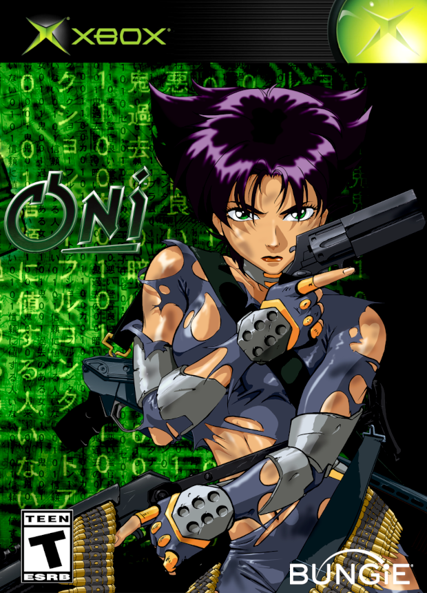
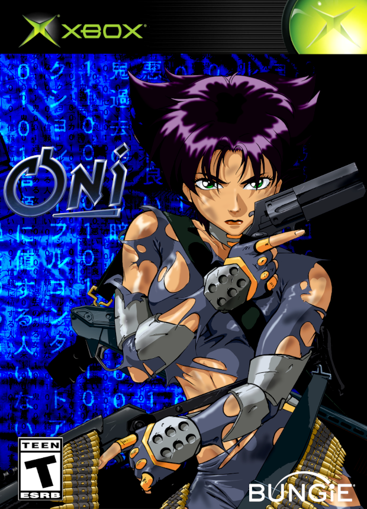

# MotokoX

    
   
   
   
   
   

<i>Save data from OniFoXed, as viewed in the dashboard.</i> 

<em>Oni for the original Xbox using OniFoxed and NXDK.</em> 

# Working:
- [x] Gameplay (demo works start to finish)
- [x] Audio
- [x] Software rendering
- [x] Dual input methods (keyboard + mouse as well as controller)
- [x] 64MB support
- [x] SDL3 support
- [x] Controls + native Xbox controller input names
- [x] In-Game Reset (using [IGR_SDL3](https://github.com/cyberiainteraktiv/cyberia-nxdk-libraries))
- [x] Native Xbox-style savegames
- [x] Running from XISO/ISO/CD/DVD

# Partially working:
- [x] Hardware rendering (has occasional stutters)
- [x] Auto resolution detection for 480p and 720p (game still renders at 480p, and 720p performance hasn't been tested, but may only be viable on 128MB systems)

# Not working:
- [ ] Xemu support
- [ ] Bink video support (so intro and outro videos don't currently work)

# Planned:
- [ ] Vibration
- [ ] Demo

# Not Planned:
- [ ] AE support or anything outside of a 1:1 port of the original game, as the port should feel like a native console release.

# Untested:
- [ ] Full retail gameplay (currently tested against the Windows demo)

# Installation
- Create a new folder called "Oni" anywhere on your system
- Copy your "GameDataFolder" folder from your Mac version or Windows demo version (1.1) of Oni beside "default.xbe". Retail game data is not provided with this port, nor will it ever be, but demo data may be provided at some point.
- Download and extract the latest release .zip file to your folder of choice, selecting "yes" if asked if you'd like to replace any existing files.
- You can then either package the folder as an .XISO, burn it to a disk, or copy it to your HDD to run it.
- Run the game and that's it! Bungie's 2001 cult classic on your Xbox, a glimpse into what we could've had.
- To copy/delete your save data, you can manage it from the Xbox dashboard like any retail Xbox game.

# Building (NXDK)

- TBA

# Credits

- Bungie - Oni
- Rockstar Canada - Original controller input method that this port borrows
- Mayo1970 - Renderer fixes + subtitle utility + profiling & optimization

Original README below.

# OniFoxed

## What's this?

This is a modified variant of the recently
leaked [Oni source code](https://archive.org/details/oni-source) so that it compiles
under Microsoft Visual Studio 2019 with some
minor fixes/changes.

The code is aligned to be run against the [Windows
demo version](https://archive.org/details/OniDemo) of the game, and because of this there are quite a few
issues when running this against the final retail
version of the game.

## What are you trying to accomplish?

Well, I wanted to get it compiling and running; I've
accomplished this.

Looking into the future I'd love to see the following,
but time is an issue for me - contributions are welcome!

- [ ] Migrate the projects to CMake
- [ ] Fix alignment issues against the final PC release
- [ ] Linux and macOS support
- [ ] Modernized renderer, with support for shaders
- [ ] 64-bit compatibility
